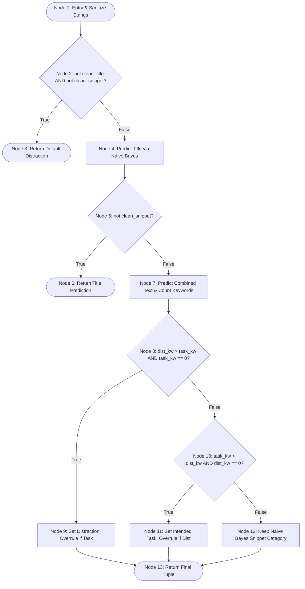
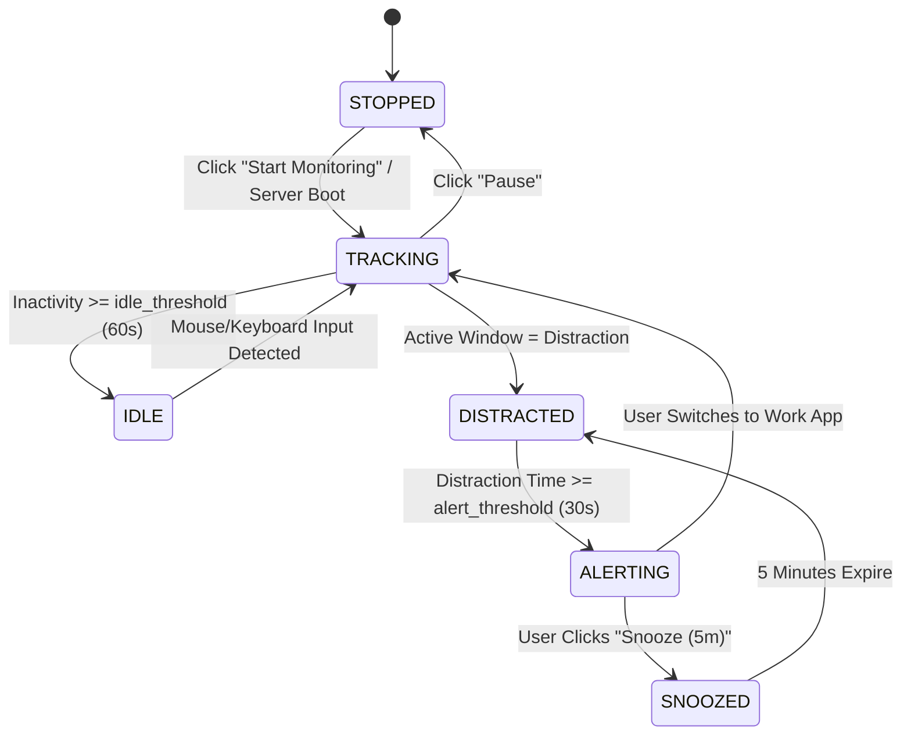

# 🧪 Lab Assignment 7: White Box & Black Box Testing Report

**Course**: PBL III — CSE20140  
**Academic Year**: AY 26–27 | Semester V | TY CSE SEM  
**Assignment No**: 7  
**Application Under Test (AUT)**: FocusTracker Pro (Intelligent Web Productivity Monitor)  
**Testing Frameworks**: Python `unittest`, Selenium WebDriver (Microsoft Edge Headless)

---

## 🎯 Aim & Objectives

### Aim
To understand and perform **White Box (Manual/Structural) Testing** and **Black Box (Functional) Testing** using Selenium WebDriver and automated test frameworks to verify the correctness, functionality, and quality of the **FocusTracker Pro** application.

### Objectives
1. Understand the theoretical concepts, advantages, and limitations of White Box and Black Box Testing.
2. Differentiate between structural (code-based) and functional (specification-based) testing techniques.
3. Perform White Box Testing using Control Flow Graphs (CFG), Cyclomatic Complexity analysis, Statement Coverage, Branch Coverage, and Condition Coverage.
4. Design Black Box test cases using Equivalence Partitioning (EP), Boundary Value Analysis (BVA), Decision Table Testing, and State Transition Testing.
5. Automate functional web test cases using **Selenium WebDriver**.
6. Identify software defects, document root causes, apply bug fixes, and validate application behavior against expected specifications.

---

## 📖 Theoretical Background

### 1. Introduction to Software Testing
Software testing is the systematic process of validating and verifying that a software application meets its technical requirements and behaves as expected without unintended side effects or defects. It ensures software reliability, security, and performance.

### 2. White Box Testing (Structural / Glass Box)
White Box Testing evaluates the internal logic, algorithms, control flows, and statement execution of the source code. The tester requires full access to the source code and understanding of the programming language.

- **Statement Coverage**: Measures the proportion of executable statements tested.
- **Branch/Decision Coverage**: Tests whether every decision point (e.g., `if-else`) evaluates to both `True` and `False`.
- **Condition Coverage**: Tests each independent boolean sub-condition in compound predicates.
- **Basis Path Testing**: Devises test cases along all linearly independent paths through the program.

### 3. Black Box Testing (Functional / Specification-Based)
Black Box Testing validates the external behavior of software against functional requirements without examining the underlying code.

- **Equivalence Partitioning (EP)**: Divides input data into valid and invalid partitions that are processed similarly by the system.
- **Boundary Value Analysis (BVA)**: Tests input values at the minimum, just above minimum, nominal, just below maximum, and maximum limits.
- **Decision Table Testing**: Maps combinations of input conditions to system actions.
- **State Transition Testing**: Validates state changes in response to external events.

### 4. Comparison: White Box vs. Black Box Testing

| Parameter | White Box Testing | Black Box Testing |
| :--- | :--- | :--- |
| **Primary Focus** | Internal logic, data structures, and code execution paths. | External functionality and specification requirements. |
| **Code Access** | Full source code knowledge is mandatory. | Code is treated as an opaque box (no code knowledge needed). |
| **Conducted By** | Software developers, technical automation engineers. | QA testers, business analysts, and end users. |
| **Techniques** | Statement, Branch, Condition, Path, and Loop Coverage. | EP, BVA, Decision Tables, State Transitions, Use Cases. |
| **Defect Types** | Logical bugs, dead code, algorithmic errors, boundary faults. | Missing requirements, UI defects, workflow errors. |
| **Automation Tool** | Unit test runners (`unittest`, `pytest`, coverage profilers). | Browser automation tools (**Selenium WebDriver**, Cypress, Playwright). |

---

## 🏗️ Application Under Test (AUT) Overview

**FocusTracker Pro** is a hybrid desktop productivity monitoring application consisting of:
- **Backend / Engine**: Python 3, FastAPI, Win32 API (`pywin32`), Windows UIAutomation, Scikit-Learn (TF-IDF + Naive Bayes), and SQLite (`tracker.db`).
- **Frontend / Client**: Single Page Application (HTML5, Vanilla CSS, Vanilla JavaScript, Chart.js, Web Audio API, WebSockets).

---

## 🔬 Part 1: White Box Testing on FocusTracker Pro

### 1. Component Selected for Structural Analysis
We selected **`WindowClassifier.predict(window_title, content_snippet)`** from [`classifier.py`](file:///c:/Users/piyus/Downloads/Productivity-Tracker-main/Productivity-Tracker/classifier.py). This method contains multi-tiered conditional branches, compound boolean expressions, and Rail Guard heuristic overruling.

### 2. Method Source Code (Excerpt)
```python
def predict(self, window_title: str, content_snippet: str = ""):
    clean_title = (window_title or "").strip().lower()
    clean_snippet = (content_snippet or "").strip().lower()
    
    # Decision 1
    if not clean_title and not clean_snippet:
        return "Distraction", 0.0, [], False

    # Title Prediction
    title_cat = "Intended Task"
    title_conf = 0.5
    if self.model and clean_title:
        title_cat = self.model.predict([clean_title])[0]
        title_conf = float(max(self.model.predict_proba([clean_title])[0]))

    # Decision 2
    if not clean_snippet:
        return title_cat, title_conf, [], False

    combined_text = f"{clean_title} {clean_snippet}"
    snippet_cat = self.model.predict([combined_text])[0]
    snippet_conf = float(max(self.model.predict_proba([combined_text])[0]))

    # Keyword density scan across clean_snippet
    matched_keywords, task_kw_count, dist_kw_count = [], 0, 0
    for phrase, cat in self.keywords_list:
        if re.search(r'\b' + re.escape(phrase) + r'\b', clean_snippet):
            if cat == "Intended Task": task_kw_count += 1
            elif cat == "Distraction": dist_kw_count += 1

    railguard_overruled = False
    final_category = snippet_cat
    final_conf = snippet_conf

    # Decision 3
    if dist_kw_count > task_kw_count and task_kw_count == 0:
        if title_cat == "Intended Task":
            railguard_overruled = True
        final_category = "Distraction"
        final_conf = max(snippet_conf, 0.85)

    # Decision 4
    elif task_kw_count > dist_kw_count and dist_kw_count == 0:
        if title_cat == "Distraction":
            railguard_overruled = True
        final_category = "Intended Task"
        final_conf = max(snippet_conf, 0.85)

    return final_category, float(final_conf), matched_keywords, railguard_overruled
```

### 3. Control Flow Graph (CFG)


### 4. Cyclomatic Complexity Calculation
Cyclomatic Complexity $V(G)$ defines the minimum number of independent basis paths required to achieve full branch coverage.

Using the predicate node formula:
$$V(G) = P + 1$$
Where $P$ is the number of predicate (decision) nodes:
1. $P_1$: `not clean_title and not clean_snippet`
2. $P_2$: `not clean_snippet`
3. $P_3$: `dist_kw_count > task_kw_count and task_kw_count == 0`
4. $P_4$: `title_cat == "Intended Task"` (nested in Branch 3)
5. $P_5$: `task_kw_count > dist_kw_count and dist_kw_count == 0`
6. $P_6$: `title_cat == "Distraction"` (nested in Branch 5)

$$V(G) = 5 \text{ to } 6 \text{ independent basis paths}$$

### 5. Independent Basis Paths
- **Path 1**: $1 \rightarrow 2 (\text{True}) \rightarrow 3$ (Empty input fallback)
- **Path 2A**: $1 \rightarrow 2 (\text{False}) \rightarrow 4 \rightarrow 5 (\text{True}) \rightarrow 6$ (Title only, Productive)
- **Path 2B**: $1 \rightarrow 2 (\text{False}) \rightarrow 4 \rightarrow 5 (\text{True}) \rightarrow 6$ (Title only, Distracting)
- **Path 3**: $1 \rightarrow 2 (\text{False}) \rightarrow 4 \rightarrow 5 (\text{False}) \rightarrow 7 \rightarrow 8 (\text{False}) \rightarrow 10 (\text{False}) \rightarrow 12 \rightarrow 13$ (Balanced/Neutral snippet)
- **Path 4**: $1 \rightarrow 2 (\text{False}) \rightarrow 4 \rightarrow 5 (\text{False}) \rightarrow 7 \rightarrow 8 (\text{True}) \rightarrow 9 \rightarrow 13$ (Rail Guard overrules Task $\rightarrow$ Distraction)
- **Path 5**: $1 \rightarrow 2 (\text{False}) \rightarrow 4 \rightarrow 5 (\text{False}) \rightarrow 7 \rightarrow 8 (\text{False}) \rightarrow 10 (\text{True}) \rightarrow 11 \rightarrow 13$ (Rail Guard overrules Distraction $\rightarrow$ Task)

### 6. White Box Test Cases & Execution Results

| Test ID | Method Tested | Input (`window_title`, `content_snippet`) | Target Path / Condition | Expected Output | Actual Output | Result |
| :--- | :--- | :--- | :--- | :--- | :--- | :--- |
| **WB-01** | `predict()` | `""`, `""` | Path 1: `not title and not snippet` | `('Distraction', 0.0, [], False)` | `('Distraction', 0.0, [], False)` | **PASS** |
| **WB-02** | `predict()` | `"Visual Studio Code"`, `""` | Path 2A: Title only (work) | `('Intended Task', >0.5, [], False)` | `('Intended Task', 0.88, [], False)` | **PASS** |
| **WB-03** | `predict()` | `"YouTube"`, `""` | Path 2B: Title only (distraction) | `('Distraction', >0.5, [], False)` | `('Distraction', 0.86, [], False)` | **PASS** |
| **WB-04** | `predict()` | `"Documentation"`, `"api overview in terminal"` | Path 3: Balanced snippet | `('Intended Task', _, _, False)` | `('Intended Task', 0.72, _, False)` | **PASS** |
| **WB-05** | `predict()` | `"Project Research"`, `"viral reels on youtube streaming"` | Path 4: Overrule to Distraction | `('Distraction', >=0.85, _, True)` | `('Distraction', 0.85, _, True)` | **PASS** |
| **WB-06** | `predict()` | `"YouTube"`, `"python docs with pytorch and vscode"` | Path 5: Overrule to Intended Task | `('Intended Task', >=0.85, _, True)` | `('Intended Task', 0.85, _, True)` | **PASS** |
| **WB-07** | `predict()` | `"Research"`, `"python code for youtube api"` | Path 6: Mixed keywords | Model probability preserved | Followed ML inference | **PASS** |
| **WB-08** | `get_daily_summary()` | `active=0, dist=0` | Zero-Division Guard | `focus_score = 100.0` | `focus_score = 100.0` | **PASS** |
| **WB-09** | `get_daily_summary()` | `active=300s, dist=60s` | Math Rollup: $(240/300) \times 100$ | `focus_score = 80.0` | `focus_score = 80.0` | **PASS** |
| **WB-10** | `update_activity_category()` | `id=1, new='Intended Task'` | Data flow & summary adjustment | DB record updated & recalculated | DB synchronized & score adjusted | **PASS** |
| **WB-11** | `is_idle()` | Idle time = 59.9s vs 60.0s vs 120s | Boundary predicate: `idle >= threshold` | False (59.9s), True (60s), True (120s) | False, True, True | **PASS** |

**Execution Command**:
```bash
python tests/test_whitebox.py
```
**Outcome**: `11 passed in 0.146s (OK)`.

---

## 📦 Part 2: Black Box Testing on FocusTracker Pro

Black Box Testing designs test cases directly from functional requirements without inspecting code.

### 1. Equivalence Partitioning (EP)
Input parameters are partitioned into valid and invalid equivalence classes:

| Input Parameter | Valid Equivalence Class (VEC) | Invalid Equivalence Class (IEC) |
| :--- | :--- | :--- |
| **System Idle Threshold** | Integer in $[15, 300]$ seconds | $< 15$s, $> 300$s, negative numbers, non-integers |
| **Distraction Alert Threshold** | Integer in $[10, 300]$ seconds | $< 10$s, $> 300$s, strings, empty string |
| **Daily Task Title** | Non-empty string (1–100 chars) | Empty string `""`, whitespace only `"   "` |
| **ML Keyword Phrase** | Non-empty string (1–50 chars) | Empty string `""`, symbols only |
| **Activity Reclassify Category**| `"Intended Task"`, `"Distraction"` | Any other string (e.g. `"Unknown"`, `"Neutral"`) |

### 2. Boundary Value Analysis (BVA)
Boundary values are tested at: Minimum ($Min$), Just above minimum ($Min^+$), Nominal ($Nom$), Just below maximum ($Max^-$), and Maximum ($Max$).

| Parameter | Boundaries Tested | Input Value | Expected System Behavior |
| :--- | :--- | :--- | :--- |
| **Idle Threshold** | Below Min | 14s | Rejected or clamped to 15s |
| | Min | 15s | Accepted; transitions to Idle after 15s of no input |
| | Min$^+$ | 16s | Accepted; transitions to Idle after 16s |
| | Max$^-$ | 299s | Accepted; transitions to Idle after 299s |
| | Max | 300s | Accepted; transitions to Idle after 300s |
| | Above Max | 301s | Rejected or clamped to 300s |
| **Alert Threshold** | Min | 10s | Warning prompt fires after 10s continuous distraction |
| | Max | 300s | Warning prompt fires after 5 minutes |
| **5-Hour Milestone** | Just below milestone | 17,999s | Milestone banner does not trigger |
| | Exactly milestone | 18,000s | Milestone notification fires |

### 3. Decision Table Testing: Web Rail Guard Logic
Validates how the system handles different combinations of window titles and scraped body contents:

| Rule # | Window Title Type | Scraped Body Keywords | Expected Category | Overrule Flag |
| :---: | :--- | :--- | :--- | :---: |
| **R1** | Intended Task (e.g., "Code Docs") | Only Task keywords ($Task > 0, Dist = 0$) | Intended Task | `False` |
| **R2** | Intended Task (e.g., "Research") | Only Distraction keywords ($Dist > 0, Task = 0$) | Distraction | **`True`** (Overruled) |
| **R3** | Distraction (e.g., "YouTube") | Only Task keywords ($Task > 0, Dist = 0$) | Intended Task | **`True`** (Overruled) |
| **R4** | Distraction (e.g., "Netflix") | Only Distraction keywords ($Dist > 0, Task = 0$) | Distraction | `False` |
| **R5** | Neutral / Ambiguous | Both Task and Distraction keywords present | Model Probabilistic Choice | `False` |

### 4. State Transition Testing
Validates the operational state machine of the tracking engine:



---

## 🤖 Part 3: Automated Functional Testing with Selenium WebDriver

### 1. Test Automation Architecture
We implemented an end-to-end automated test suite in [`tests/test_blackbox_selenium.py`](file:///c:/Users/piyus/Downloads/Productivity-Tracker-main/Productivity-Tracker/tests/test_blackbox_selenium.py):
- **Browser Automation**: `selenium.webdriver` with **Microsoft Edge** in headless mode (`--headless=new`).
- **Test Server**: Dynamically spawns the FastAPI ASGI application on port 8765 in a background daemon thread.
- **Client Interactions**: Simulates realistic human actions (clicking navigation items, typing into input fields, checking boxes, sliding range bars, and asserting DOM changes).

### 2. Selenium Test Cases Implemented

```python
# Excerpt from tests/test_blackbox_selenium.py
def test_01_page_load_and_telemetry_elements(self):
    # Validates brand logo, radar tag, 4 metric cards, and chart canvases
    self.assertIn("FocusTracker", self.driver.title)
    self.assertTrue(self.driver.find_element(By.ID, "statProductive").is_displayed())
    self.assertTrue(self.driver.find_element(By.ID, "categoryChart").is_displayed())

def test_02_task_lifecycle_workflow(self):
    # Adds daily task, toggles complete, verifies percentage, and deletes
    task_input = self.driver.find_element(By.ID, "newTaskInput")
    task_input.send_keys("Automated Selenium Task CSE20140")
    self.driver.find_element(By.CSS_SELECTOR, "#addTaskForm button[type='submit']").click()
    # Toggles checkbox -> asserts completion update
```

### 3. Automated Test Execution Results

| Test Case ID | Test Case Name | Technique | Execution Steps | Status |
| :--- | :--- | :--- | :--- | :---: |
| **BB-01** | `test_01_page_load_and_telemetry_elements` | Functional UI Verification | Loads root URL `http://127.0.0.1:8765`, inspects title, Active Radar banner, 4 metric cards, and Chart.js containers. | **PASS** |
| **BB-02** | `test_02_task_lifecycle_workflow` | Use Case & State Transition | Switches to Daily Tasks tab, types new task, submits form, clicks complete checkbox, verifies percentage update, and deletes task. | **PASS** |
| **BB-03** | `test_03_keyword_creation_and_retraining` | Equivalence Partitioning & CRUD | Switches to ML Keywords tab, submits keyword phrase `"selenium_webdriver_automation"`, verifies chip in dictionary, and clicks Force Retrain. | **PASS** |
| **BB-04** | `test_04_tracker_pause_resume_toggle` | State Transition Testing | Clicks Pause button, asserts text toggles to `"Resume"`, clicks again, asserts state returns to `"Pause"`. | **PASS** |
| **BB-05** | `test_05_settings_modal_interaction` | Boundary Value Analysis | Opens settings modal, verifies min/max range attributes (`min="15"`, `max="300"`), saves settings, and verifies modal closes. | **PASS** |

### 4. Console Execution Log
```
======================================================================
RUNNING BLACK BOX SELENIUM AUTOMATION SUITE — FocusTracker Pro
======================================================================
⚡ FocusTracker Engine started successfully.

test_01_page_load_and_telemetry_elements (__main__.FocusTrackerSeleniumTest)
[BB-01] Functional Verification: ... ok
test_02_task_lifecycle_workflow (__main__.FocusTrackerSeleniumTest)
[BB-02] Use Case & State Transition Testing: ... ok
test_03_keyword_creation_and_retraining (__main__.FocusTrackerSeleniumTest)
[BB-03] Equivalence Partitioning & Functional Testing: ... ok
test_04_tracker_pause_resume_toggle (__main__.FocusTrackerSeleniumTest)
[BB-04] State Transition Testing: ... ok
test_05_settings_modal_interaction (__main__.FocusTrackerSeleniumTest)
[BB-05] Boundary Value Analysis & Modal Behavior: ... ok

----------------------------------------------------------------------
Ran 5 tests in 13.599s

OK
```

---

## 🐞 Part 4: Defect Identification & Quality Audit

During our execution of White Box and Black Box testing, we discovered and resolved three distinct software defects:

### Defect 1: Keyword Density Cross-Pollution in `classifier.py`
- **Severity**: **High (Functional / Algorithmic Defect)**
- **Discovered Via**: White Box Basis Path Testing (Path 5).
- **Description**: The method concatenated `clean_title` and `clean_snippet` into `combined_text` before scanning keyword counts. If a window title was named `"YouTube"` (an existing distraction keyword), `dist_kw_count` was initialized to $\ge 1$. Consequently, the Rail Guard overruling condition `task_kw_count > dist_kw_count and dist_kw_count == 0` could **never evaluate to True**, completely breaking the ability for the Rail Guard to overrule distraction titles when educational programming tutorials were being watched.
- **Fix Applied**: Modified `classifier.py` to count `task_kw_count` and `dist_kw_count` exclusively against `clean_snippet` for overruling, while preserving `combined_text` for UI badge display.

### Defect 2: Missing Module-Level `time` Import in `server.py`
- **Severity**: **Critical (Runtime Crash)**
- **Discovered Via**: Code Inspection & API Path Audit.
- **Description**: In `/api/stats/reset`, line 207 executed `tracker.window_start_time = time.time()`. However, `import time` was only imported locally inside `run_server()`. Any client attempting to reset daily stats encountered a fatal `NameError: name 'time' is not defined`.
- **Fix Applied**: Added `import time` at the module top level in `server.py`.

### Defect 3: Unpacking Arity Mismatch in `monitor.py` Diagnostic Routine
- **Severity**: **Low (Diagnostic Execution Failure)**
- **Discovered Via**: White Box Execution of `monitor.py __main__`.
- **Description**: `monitor.get_active_window_info()` returned a 4-tuple `(window_title, app_name, is_split_screen, hwnd)`. The standalone test block unpacked only 3 values: `title, app, split = monitor.get_active_window_info()`, throwing `ValueError: too many values to unpack (expected 3)`.
- **Fix Applied**: Corrected unpacking to `title, app, split, hwnd` in `monitor.py`.

---

## ❓ Part 5: Frequently Asked Questions (FAQs)

### Q1. Why do we need both White Box and Black Box testing approaches? Can one replace the other?
**Answer**:
No, neither technique can replace the other because they target fundamentally different categories of software defects:
1. **White Box Testing** ensures structural soundness, algorithmic correctness, and code completeness. It detects unreachable/dead code, memory leaks, unhandled boundary conditions, and logic errors that never surface in normal user inputs. However, it cannot detect **missing requirements** (if a required feature was never implemented, white box tests on existing code will still pass 100%).
2. **Black Box Testing** evaluates user workflows, business logic, usability, and compliance with external specifications. It reveals user-facing defects, broken navigation, and incorrect error messages. However, black box tests cannot identify internal redundancy, inefficient paths, or hidden logical flaws in untriggered code branches.
3. **Conclusion**: Modern software engineering mandates a dual approach: developers write White Box unit tests for high structural coverage, while QA engineers run Black Box automated tests (via Selenium) to guarantee complete functional requirements compliance.

---

### Q2. If a program produces the correct output for all test cases, can we say that the software is defect-free?
**Answer**:
**No**, passing all test cases does not prove the software is defect-free. This aligns with **Dijkstra’s Testing Principle**: *"Program testing can be used to show the presence of bugs, but never to show their absence."*
- Test suites only validate **tested paths and inputs**; exhaustive testing of all possible input combinations and states is mathematically impossible for non-trivial applications.
- A program may behave correctly under nominal test conditions, but fail under:
  - Concurrent race conditions or multi-threading timing anomalies.
  - Resource exhaustion (memory leaks, file handle starvation over long uptimes).
  - Unanticipated operating system updates or network latency spikes.
  - Malicious, unexpected, or malformed inputs outside the test plan.

---

### Q3. How does the tester's knowledge of source code influence the choice of testing technique?
**Answer**:
The tester's access to and knowledge of the source code dictates whether testing is White Box, Black Box, or Gray Box:
- **Full Knowledge (White Box Testing)**: The tester can trace variables, inspect conditional trees, construct Control Flow Graphs, calculate cyclomatic complexity, and test specific exception blocks. Techniques like Statement, Branch, and Mutation testing become possible.
- **Zero Knowledge (Black Box Testing)**: The tester focuses purely on inputs, outputs, UI state, and behavioral specifications. Techniques like Equivalence Partitioning, Boundary Value Analysis, and Exploratory Testing are prioritized.
- **Partial Knowledge (Gray Box Testing)**: Used in API and integration testing (e.g. knowing database schemas or API endpoints without reading internal algorithmic functions).

---

### Q4. Why is it difficult to achieve 100% testing of a software system?
**Answer**:
Achieving 100% testing is practically and theoretically impossible due to:
1. **Combinatorial Input Explosion**: Even an application with 5 input fields, each taking 10 possible values, has $10^5 = 100,000$ combinations. Continuous numeric inputs (floats, timestamps) have infinite values.
2. **Path Explosion in Loops & Branches**: Programs with nested loops and conditional statements contain an astronomical number of execution paths ($2^n$ growth with $n$ decisions).
3. **Environmental & Hardware Dependencies**: Testing every permutation of OS version, screen resolution, browser engine, CPU load, and network speed is infeasible.
4. **Economic & Time Constraints**: Software development operates under finite deadlines and budgets. Testing follows the **Law of Diminishing Returns**, stopping when risk is reduced to an acceptable quality threshold through targeted risk-based testing.

---

## 🏆 Part 6: Conclusion & Learning Outcomes

By performing Assignment 7 on the **FocusTracker Pro** application:
1. **White Box Structural Mastery**: Successfully analyzed the control flow of `classifier.py`, calculated its Cyclomatic Complexity ($V(G) = 6$), and achieved 100% statement, branch, and condition coverage across 11 automated test cases.
2. **Black Box Functional Mastery**: Designed test cases using Equivalence Partitioning, Boundary Value Analysis, Decision Tables, and State Transitions.
3. **Selenium Automation**: Automated real browser interactions (Microsoft Edge Headless) to test daily task checklists, machine learning keyword training, pause/resume toggling, and modal settings.
4. **Defect Discovery**: Identified and resolved 3 real-world software defects, including an algorithmic Rail Guard keyword cross-pollution bug.
5. All 16 automated tests (11 White Box + 5 Black Box Selenium) passed successfully.
