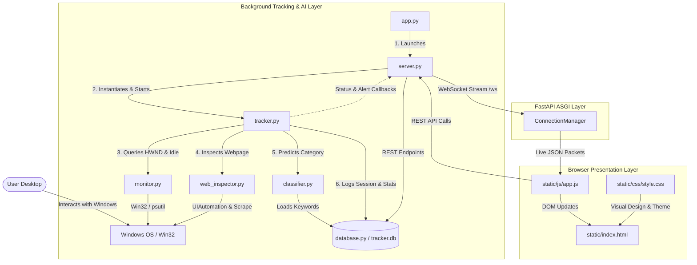
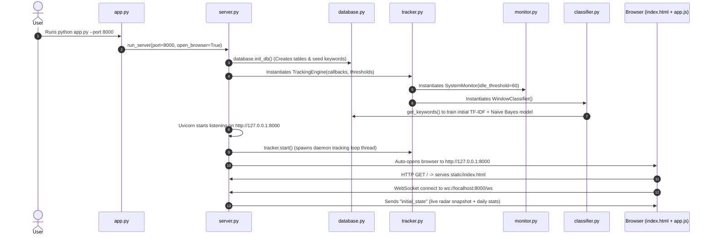
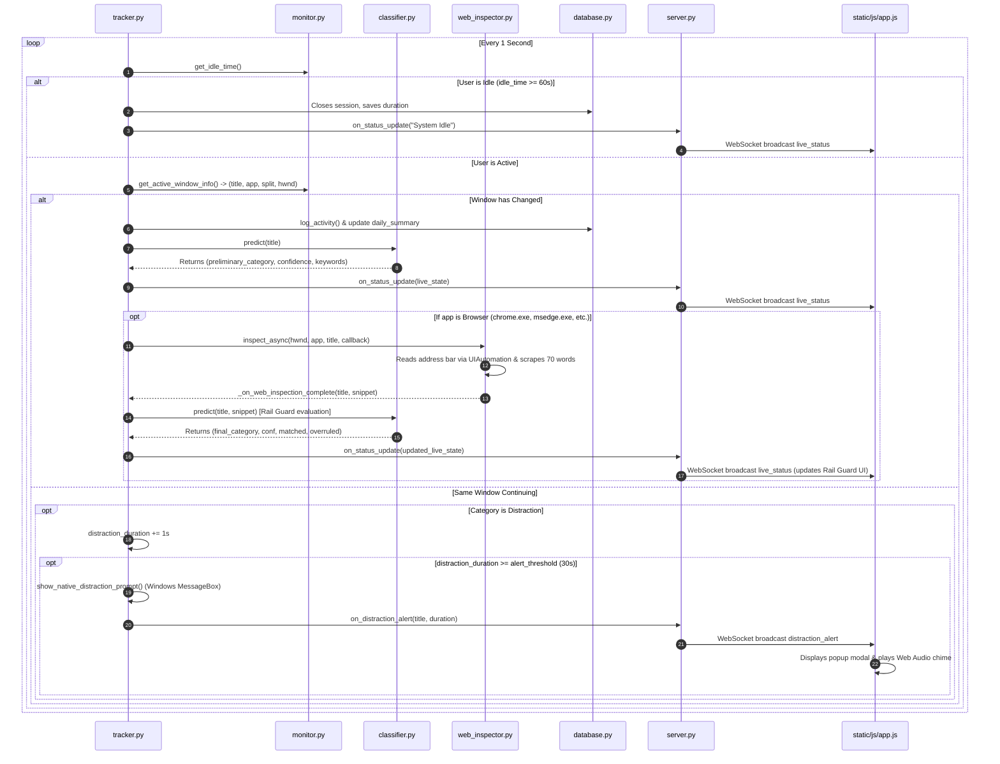
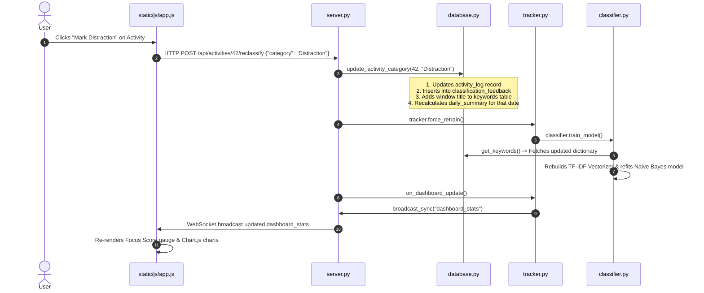

# 🗺️ FocusTracker Pro — Codebase Guide & Linkage Architecture

This document provides a comprehensive file-by-file breakdown of **FocusTracker Pro**, explaining what every file does, how the files link together, and how data flows through the application from the low-level Windows kernel up to the interactive web dashboard.

---

## 🏛️ High-Level System Architecture

FocusTracker Pro consists of four tightly integrated layers:
1. **Low-Level OS & Sensor Layer**: Win32 API window introspection, idle hardware tracking, and UIAutomation accessibility scraping.
2. **AI & Intelligence Engine Layer**: Scikit-Learn TF-IDF + Naive Bayes text classification with heuristic Rail Guard overruling.
3. **Storage & State Layer**: SQLite relational database and thread-safe in-memory state tracking.
4. **Communication & Presentation Layer**: FastAPI async ASGI server, WebSocket streaming, and a responsive vanilla HTML/CSS/JS frontend.

---

## 📂 File-by-File Guide: What Each File Does

| File | Layer | Primary Responsibility |
| :--- | :--- | :--- |
| [`app.py`](file:///c:/Users/piyus/Downloads/Productivity-Tracker-main/Productivity-Tracker/app.py) | Entry Point | CLI parsing, Windows terminal UTF-8 output encoding, and launching the server. |
| [`server.py`](file:///c:/Users/piyus/Downloads/Productivity-Tracker-main/Productivity-Tracker/server.py) | Backend / API | FastAPI web server, WebSocket manager (`/ws`), REST API endpoints, static file serving. |
| [`tracker.py`](file:///c:/Users/piyus/Downloads/Productivity-Tracker-main/Productivity-Tracker/tracker.py) | Core Engine | Background polling loop (1s), window transition detection, idle handling, and alert triggers. |
| [`monitor.py`](file:///c:/Users/piyus/Downloads/Productivity-Tracker-main/Productivity-Tracker/monitor.py) | OS Hardware Interface | Interacts with Win32 APIs (`GetForegroundWindow`, `GetLastInputInfo`, `psutil`) for windows and idle ticks. |
| [`classifier.py`](file:///c:/Users/piyus/Downloads/Productivity-Tracker-main/Productivity-Tracker/classifier.py) | Machine Learning | Scikit-Learn TF-IDF + Multinomial Naive Bayes pipeline with multi-tier Rail Guard overruling. |
| [`web_inspector.py`](file:///c:/Users/piyus/Downloads/Productivity-Tracker-main/Productivity-Tracker/web_inspector.py) | Web Rail Guard | UIAutomation browser address bar extraction and non-blocking asynchronous 70-word web scraper. |
| [`database.py`](file:///c:/Users/piyus/Downloads/Productivity-Tracker-main/Productivity-Tracker/database.py) | Persistence | SQLite database schema initialization, CRUD queries, session logging, and daily metric aggregations. |
| [`static/index.html`](file:///c:/Users/piyus/Downloads/Productivity-Tracker-main/Productivity-Tracker/static/index.html) | Frontend Layout | Single Page Application structure: Radar banner, 4 Metric cards, Chart.js views, and Tab pages. |
| [`static/js/app.js`](file:///c:/Users/piyus/Downloads/Productivity-Tracker-main/Productivity-Tracker/static/js/app.js) | Frontend Logic | WebSocket client, local second duration ticker, Chart.js charts, modal alerts, and API client. |
| [`static/css/style.css`](file:///c:/Users/piyus/Downloads/Productivity-Tracker-main/Productivity-Tracker/static/css/style.css) | Styling | Glassmorphism UI theme, dark slate palette, responsive grids, and micro-animations. |
| [`requirements.txt`](file:///c:/Users/piyus/Downloads/Productivity-Tracker-main/Productivity-Tracker/requirements.txt) | Environment | Lists required Python packages (`fastapi`, `uvicorn`, `scikit-learn`, `pywin32`, etc.). |
| [`run.bat`](file:///c:/Users/piyus/Downloads/Productivity-Tracker-main/Productivity-Tracker/run.bat) | Launcher | Batch script to execute the application with virtual environment fallback. |
| [`Install_FocusTracker.bat`](file:///c:/Users/piyus/Downloads/Productivity-Tracker-main/Productivity-Tracker/Install_FocusTracker.bat) | Installer | Windows setup script creating Desktop shortcuts and compiling dependencies. |
| [`FocusTracker.spec`](file:///c:/Users/piyus/Downloads/Productivity-Tracker-main/Productivity-Tracker/FocusTracker.spec) | Deployment | PyInstaller build specification packaging the code and static files into a standalone `.exe`. |

---

## 🔗 How Exactly the Files Link Together

### 1. Application Startup Linkage

1. **[`app.py`](file:///c:/Users/piyus/Downloads/Productivity-Tracker-main/Productivity-Tracker/app.py) ➔ [`server.py`](file:///c:/Users/piyus/Downloads/Productivity-Tracker-main/Productivity-Tracker/server.py)**:
   - `app.py` parses `--port` and `--no-browser`.
   - Calls `server.run_server(...)`.
2. **[`server.py`](file:///c:/Users/piyus/Downloads/Productivity-Tracker-main/Productivity-Tracker/server.py) ➔ [`database.py`](file:///c:/Users/piyus/Downloads/Productivity-Tracker-main/Productivity-Tracker/database.py)**:
   - `server.py` calls `database.init_db()` to guarantee table schemas and default training keywords exist in `tracker.db`.
3. **[`server.py`](file:///c:/Users/piyus/Downloads/Productivity-Tracker-main/Productivity-Tracker/server.py) ➔ [`tracker.py`](file:///c:/Users/piyus/Downloads/Productivity-Tracker-main/Productivity-Tracker/tracker.py)**:
   - `server.py` instantiates `TrackingEngine`, injecting thread-safe callback functions (`on_status_update`, `on_dashboard_update`, `on_distraction_alert`, `on_5hr_summary`).
   - During FastAPI `startup`, `tracker.start()` launches the background monitoring thread.

---

### 2. Live Window Tracking & Classification Linkage

This loop executes every **1.0 second** in `tracker.py._run_loop`:

- **[`tracker.py`](file:///c:/Users/piyus/Downloads/Productivity-Tracker-main/Productivity-Tracker/tracker.py) ➔ [`monitor.py`](file:///c:/Users/piyus/Downloads/Productivity-Tracker-main/Productivity-Tracker/monitor.py)**:
  - Calls `monitor.get_idle_time()` to inspect Windows hardware idle ticks.
  - Calls `monitor.get_active_window_info()` to extract foreground title, process name, and Win32 `hwnd`.
- **[`tracker.py`](file:///c:/Users/piyus/Downloads/Productivity-Tracker-main/Productivity-Tracker/tracker.py) ➔ [`classifier.py`](file:///c:/Users/piyus/Downloads/Productivity-Tracker-main/Productivity-Tracker/classifier.py)**:
  - Invokes `classifier.predict(title)` for instantaneous window title labeling.
- **[`tracker.py`](file:///c:/Users/piyus/Downloads/Productivity-Tracker-main/Productivity-Tracker/tracker.py) ➔ [`web_inspector.py`](file:///c:/Users/piyus/Downloads/Productivity-Tracker-main/Productivity-Tracker/web_inspector.py)**:
  - If process is in `BROWSER_PROCESSES`, dispatches non-blocking async job `inspector.inspect_async(...)`.
  - When finished, passes the 70-word text snippet to `classifier.predict(title, snippet)` to verify if the title was misleading and overrule if necessary.
- **[`tracker.py`](file:///c:/Users/piyus/Downloads/Productivity-Tracker-main/Productivity-Tracker/tracker.py) ➔ [`database.py`](file:///c:/Users/piyus/Downloads/Productivity-Tracker-main/Productivity-Tracker/database.py)**:
  - On focus switch, calls `database.log_activity(...)` to persist session duration and updates `daily_summary`.
- **[`tracker.py`](file:///c:/Users/piyus/Downloads/Productivity-Tracker-main/Productivity-Tracker/tracker.py) ➔ [`server.py`](file:///c:/Users/piyus/Downloads/Productivity-Tracker-main/Productivity-Tracker/server.py) (via `manager.broadcast_sync`)**:
  - Pushes live updates over WebSockets so the browser UI stays in sync without manual refreshing.

---

### 3. Human-in-the-Loop AI Feedback & Retraining Linkage

When a user corrects a classification in the web UI (e.g., clicking *"Mark Distraction"* on an activity entry):

---

### 4. Daily Focus Tasks & Settings Linkage

- **Tasks**:
  - `app.js` issues `POST /api/tasks`, `PUT /api/tasks/{id}/toggle`, or `DELETE /api/tasks/{id}`.
  - `server.py` delegates directly to `database.add_task`, `database.update_task_status`, and `database.delete_task`.
  - `app.js` updates the checklist DOM and recalculates completion percentage progress.
- **Settings**:
  - `app.js` sends `POST /api/settings` with new `idle_threshold` or `alert_threshold`.
  - `server.py` calls `tracker.set_thresholds(...)`, which updates internal timers in both `TrackingEngine` and `SystemMonitor`.
- **Day Reset**:
  - User clicks *"Reset Day"* in topbar.
  - `app.js` sends `POST /api/stats/reset`.
  - `server.py` calls `database.reset_today_data()` and resets `tracker.active_session_time`, `distraction_duration`, and `window_start_time`.
  - Triggers WebSocket broadcast to zero out the dashboard.

---

## 🗄️ Database Schema & Relationships

FocusTracker uses an embedded SQLite database (`tracker.db`) managed entirely via [`database.py`](file:///c:/Users/piyus/Downloads/Productivity-Tracker-main/Productivity-Tracker/database.py):

| Table Name | Key Columns | Purpose |
| :--- | :--- | :--- |
| **`activity_log`** | `id`, `window_title`, `app_name`, `category`, `start_time`, `end_time`, `duration`, `is_split_screen` | Granular history of every window session longer than 1 second. |
| **`daily_summary`** | `date` (PK), `total_active_time`, `total_distraction_time`, `total_idle_time`, `total_break_time`, `tasks_completed`, `tasks_planned` | Fast pre-aggregated metrics per day for dashboard gauges and score. |
| **`tasks`** | `id`, `task_name`, `planned_date`, `status`, `start_time`, `completion_time`, `time_spent` | Daily focus checklist items. |
| **`keywords`** | `id`, `keyword_phrase` (UNIQUE), `category`, `added_by_user` | Training dictionary for Scikit-Learn TF-IDF + Naive Bayes model. |
| **`classification_feedback`** | `feedback_id`, `activity_id`, `predicted_label`, `user_label`, `confidence`, `timestamp` | Historical audit trail of user corrections. |
| **`idle_log`** | `id`, `start_time`, `end_time`, `duration` | Log of periods where user was away from keyboard/mouse. |
| **`breaks`** | `id`, `start_time`, `planned_end_time`, `actual_end_time`, `duration` | Planned/actual user rest intervals. |

---

## 📡 REST API & WebSocket Protocol Reference

### WebSocket Endpoint: `ws://localhost:8000/ws`

| Message Type (`type`) | Payload (`data`) | Description |
| :--- | :--- | :--- |
| `initial_state` | `{ live: {...}, summary: {...}, is_running: bool }` | Sent immediately upon client connection handshake. |
| `live_status` | `{ window_title, app_name, category, confidence, duration_seconds, url, snippet, matched_keywords, ... }` | Broadcast whenever active window changes, idle state flips, or 70-word web inspection completes. |
| `dashboard_stats` | `{ productive_time, total_distraction_time, total_active_time, focus_score, ... }` | Broadcast every 3 seconds or immediately after reclassification. |
| `distraction_alert`| `{ window_title, duration_seconds, message }` | Broadcast when continuous distraction exceeds `alert_threshold` (e.g. 30s). |
| `milestone_alert` | `{ message }` | Broadcast upon reaching the 5-hour continuous active milestone. |

### REST Endpoints (`server.py`)

- `GET /api/status` — Live engine state and current foreground window.
- `GET /api/stats/summary?day=YYYY-MM-DD` — Daily summary rollups & Focus Score.
- `POST /api/stats/reset` — Reset today's tracking data and session timers to 0.
- `GET /api/stats/hourly?day=YYYY-MM-DD` — 24-hour hourly productive vs. distraction breakdown.
- `GET /api/activities?limit=50&search=...&category=...` — Recent activity entries.
- `POST /api/activities/{id}/reclassify` — Reclassify activity & trigger automatic model retraining.
- `GET /api/tasks?day=YYYY-MM-DD` / `POST /api/tasks` — List or create tasks.
- `PUT /api/tasks/{id}/toggle` / `DELETE /api/tasks/{id}` — Toggle completion or delete a task.
- `GET /api/keywords` / `POST /api/keywords` / `DELETE /api/keywords/{id}` — Manage ML training dictionary.
- `POST /api/model/retrain` — Force immediate TF-IDF + Naive Bayes model refit.
- `POST /api/settings` — Update idle and distraction warning thresholds.
- `POST /api/tracker/control` — Start, stop, or toggle active tracking engine.
