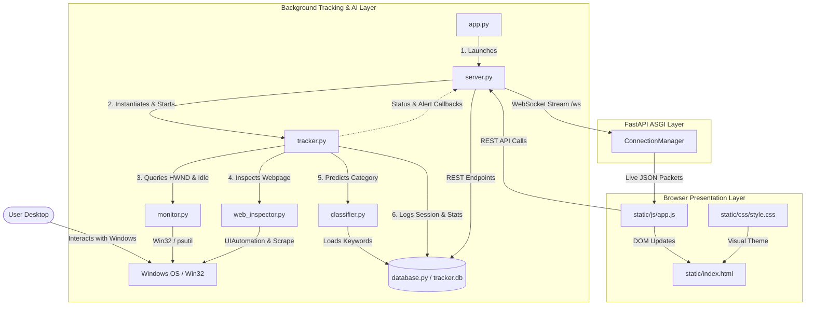

# ⚡ FocusTracker Pro — Intelligent Web Productivity Monitor

FocusTracker Pro is a real-time, low-overhead Windows productivity monitoring application. It continuously tracks active foreground desktop applications, inspects browser pages, classifies activity as **Productive / Intended Task** or **Distraction** using Machine Learning (TF-IDF + Naive Bayes), and streams live telemetry to a hardware-accelerated web dashboard.

---

### ⚡ Quick Start: One-Click Installer & Standalone EXE

1. **Standalone Executable (.exe)**:
   - Double-click [`dist/FocusTracker.exe`](file:///c:/Users/piyus/Downloads/Productivity-Tracker-main/Productivity-Tracker/dist/FocusTracker.exe) to start the engine and open the webapp immediately. No Python or terminal required!

2. **Automated Windows Installer**:
   - Double-click [`Install_FocusTracker.bat`](file:///c:/Users/piyus/Downloads/Productivity-Tracker-main/Productivity-Tracker/Install_FocusTracker.bat).
   - Automatically sets up all prerequisites, creates a **Desktop & Start Menu shortcut**, and launches the application.

3. **Quick Launcher**:
   - Run [`run.bat`](file:///c:/Users/piyus/Downloads/Productivity-Tracker-main/Productivity-Tracker/run.bat) anytime to start FocusTracker with auto-fallback to your Python environment.

---

### 🐍 Manual Python Setup (Developers)

```bash
pip install -r requirements.txt
python app.py
```

This will automatically:
1. Initialize SQLite schema & seed training dictionary in `tracker.db`.
2. Launch the FastAPI server at `http://localhost:8000`.
3. Spawn the background Win32 tracking daemon thread.
4. Auto-launch the web dashboard in your default browser.

---

## 🌟 Key Features

1. **Ultra-Low CPU Overhead**: Asynchronous FastAPI backend and hardware-accelerated, lightweight web dashboard.
2. **🤖 70-Word AI Web Rail Guard**:
   - Automatically detects active browser windows (Chrome, Edge, Brave, Firefox, Opera, etc.) using Windows UIAutomation.
   - Extracts the active URL and asynchronously scrapes the first **70 words** of readable body text.
   - Guards against **misleading window titles** (e.g., a tab named "Work Research" that actually contains gaming/video streaming content) and overrules false positives.
   - Displays a live **Web Guard AI Inspector** preview on the dashboard with matched keywords and analysis tags.
3. **Active Window Radar**: Real-time live status banner showing current foreground window, app name, emoji badge, AI classification, and ticking duration timer.
4. **Live Metrics & Focus Score**: Instant feedback on Productive Time, Distraction Time, Total Active Time, and dynamic Focus Score (%).
5. **Interactive Analytics**:
   - Productive vs Distraction Ratio Doughnut Chart.
   - 24-Hour Productivity Timeline Bar Chart (hourly breakdown).
6. **Human-in-the-Loop AI Training**:
   - Reclassify any logged window activity with 1-click ("Mark Distraction" / "Mark Task").
   - Instant automated retraining of the Naive Bayes ML classifier.
7. **Focus Task Checklist**: Add daily tasks, toggle completion with progress indicators, and filter views.
8. **Distraction & 5-Hour Milestone Alerts**:
   - Native Windows topmost warning prompts with 7-second auto-dismiss.
   - In-app visual warning modal with 5-minute snooze.
   - Synthesized Web Audio gentle warning chimes.
   - Desktop browser notifications.
9. **Configurable Settings**: Adjust system idle threshold and distraction alert timers via the settings modal.

---

## 🗂️ Project Structure & File Guide

```
Productivity-Tracker/
├── app.py                      # CLI entry point, argument parsing & server launch
├── server.py                   # FastAPI app, WebSockets (/ws), REST API & static serving
├── tracker.py                  # Core background tracking engine & polling loop
├── monitor.py                  # Low-level Windows Win32 API window & idle monitor
├── classifier.py               # Scikit-Learn TF-IDF + Naive Bayes ML classifier & Rail Guard
├── web_inspector.py            # Windows UIAutomation browser URL extractor & 70-word scraper
├── database.py                 # SQLite database layer, schema migration & analytics queries
├── tracker.db                  # Embedded SQLite database file
├── requirements.txt            # Python dependencies
├── run.bat                     # Windows quick launch script
├── Install_FocusTracker.bat    # Automated Windows installer & shortcut creator
├── build_exe.bat               # PyInstaller executable build script
├── FocusTracker.spec           # PyInstaller build specification
├── CODEBASE_GUIDE.md           # In-depth file-by-file linkage & architecture documentation
├── TECH_STACK_AND_GUIDE.md     # Technology stack reference & future project tools
└── static/                     # Frontend Single Page Application (SPA)
    ├── index.html              # Main dashboard interface layout
    ├── css/
    │   └── style.css           # Glassmorphism styling, theme tokens & responsive layout
    └── js/
        └── app.js              # Real-time WebSocket client, charts, timers & UI logic
```

For complete, detailed documentation on how every file functions and how each connects to the others, see [CODEBASE_GUIDE.md](file:///c:/Users/piyus/Downloads/Productivity-Tracker-main/Productivity-Tracker/CODEBASE_GUIDE.md).

---

## 🔗 Architecture & System Data Flow



### Core Execution Flows:
- **Active Window Polling**: Every 1.0 second, [`tracker.py`](file:///c:/Users/piyus/Downloads/Productivity-Tracker-main/Productivity-Tracker/tracker.py) queries [`monitor.py`](file:///c:/Users/piyus/Downloads/Productivity-Tracker-main/Productivity-Tracker/monitor.py) for the foreground window and hardware idle state.
- **AI Classification & Rail Guard**: Preliminary classification from window title by [`classifier.py`](file:///c:/Users/piyus/Downloads/Productivity-Tracker-main/Productivity-Tracker/classifier.py). If a browser is focused, [`web_inspector.py`](file:///c:/Users/piyus/Downloads/Productivity-Tracker-main/Productivity-Tracker/web_inspector.py) scrapes the first 70 words asynchronously and overrules the category if the content is distracting.
- **WebSocket Streaming**: Updates are broadcast through [`server.py`](file:///c:/Users/piyus/Downloads/Productivity-Tracker-main/Productivity-Tracker/server.py) to [`static/js/app.js`](file:///c:/Users/piyus/Downloads/Productivity-Tracker-main/Productivity-Tracker/static/js/app.js) over `/ws` for zero-lag dashboard updates.
- **Human-in-the-Loop Feedback**: Reclassifying an activity via the UI saves the correction to [`database.py`](file:///c:/Users/piyus/Downloads/Productivity-Tracker-main/Productivity-Tracker/database.py) and immediately retrains the Naive Bayes model.

---

## 🛠️ CLI Options

```bash
python app.py --help
python app.py --port 8080      # Run on custom port (default: 8000)
python app.py --no-browser     # Start server without auto-opening browser
```

---

## 📚 Further Documentation

- **[CODEBASE_GUIDE.md](file:///c:/Users/piyus/Downloads/Productivity-Tracker-main/Productivity-Tracker/CODEBASE_GUIDE.md)**: Exhaustive file-by-file breakdown, sequence diagrams, call graphs, database schemas, and WebSocket protocol contracts.
- **[TECH_STACK_AND_GUIDE.md](file:///c:/Users/piyus/Downloads/Productivity-Tracker-main/Productivity-Tracker/TECH_STACK_AND_GUIDE.md)**: Detailed evaluation of libraries, architectural patterns, and toolkits for building future AI desktop apps.
